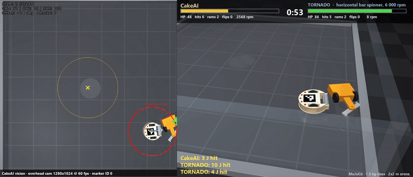
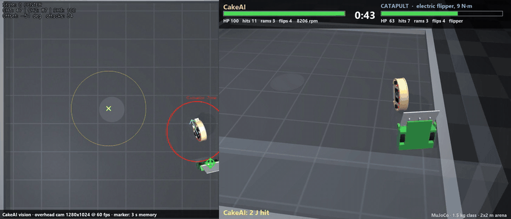
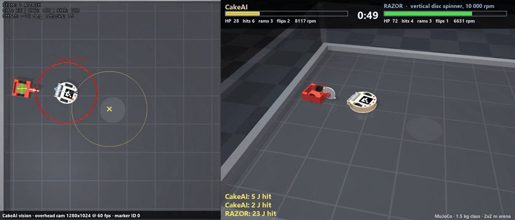
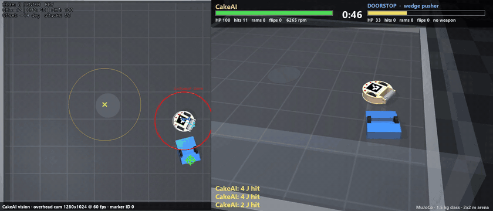
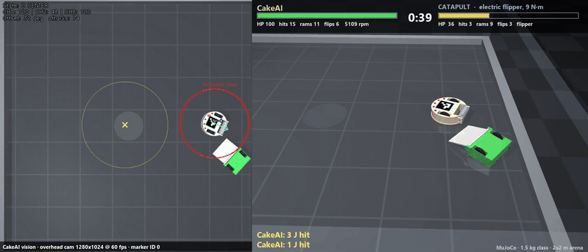
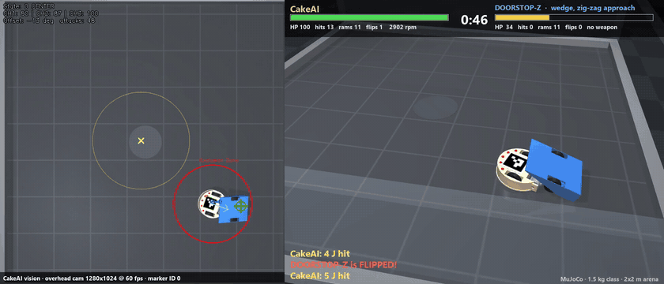
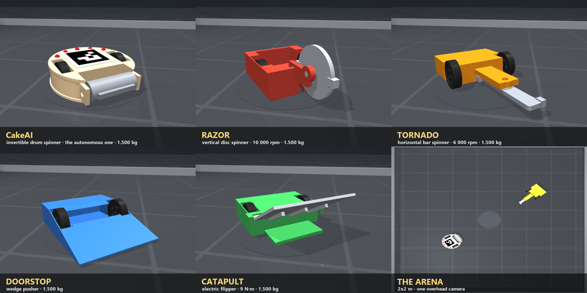
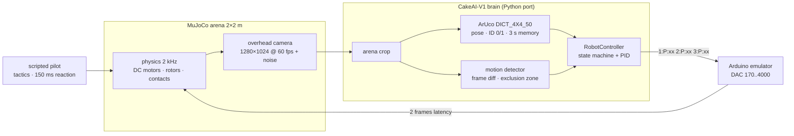
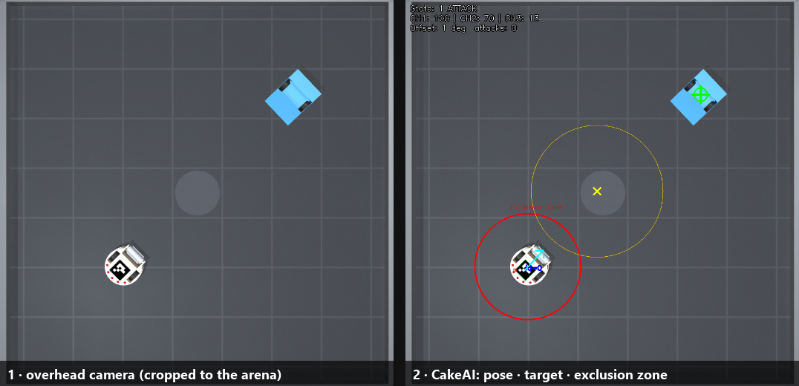
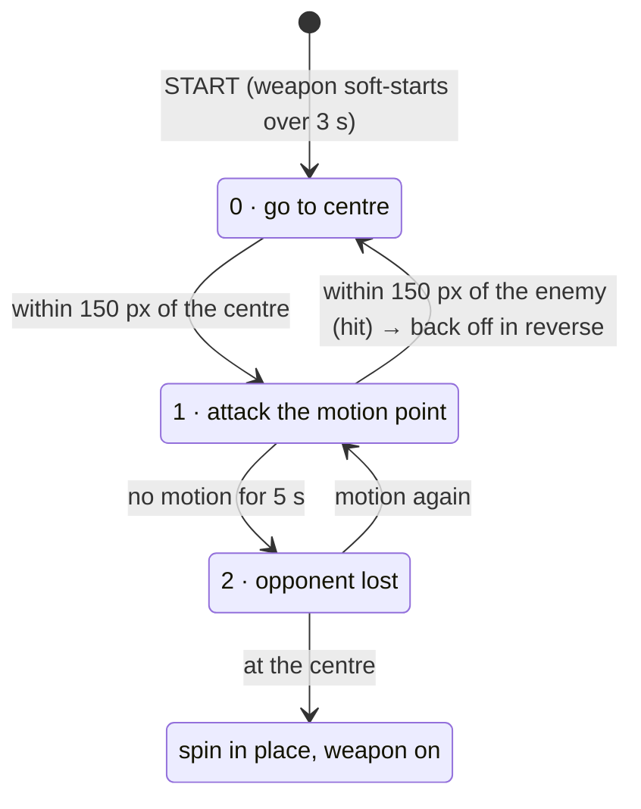

<div align="center">

# 🎂🤖 CakeAI Arena

### A MuJoCo simulator for **autonomous 1.5 kg combat robots**. The robot's AI fights with its own eyes: one overhead camera.

[](https://github.com/GeBondar/cakeai-arena/actions/workflows/ci.yml)


[](LICENSE)

**English** · [Русский](README_RU.md)


<sub>Left: what the AI sees. It finds itself by the ArUco marker and the opponent by motion. Right: the broadcast camera.</sub>

</div>

---

**CakeAI Arena** puts the real brain of [**CakeAI-V1**](https://github.com/Vlad326/CakeAI-V1) into a physics arena. CakeAI ("Tort II") is the autonomous robot that fought at Crashilovo on 25 April 2026. Its vision and control code runs unchanged in logic, driven only by pixels from a simulated overhead camera. It gets no ground truth and no cheats. It fights four kinds of 1.5 kg robots, built in CAD and simulated with real rotor physics.

- 🎥 **Camera in the loop.** A 1280×1024 overhead render goes through CakeAI's pipeline: arena crop, ArUco, motion detector, state machine. Out come `1:P:73` serial lines, then an emulated Arduino, then motors.
- 🦾 **Five robots, all exactly 1.500 kg.** They are modelled in code with CadQuery using the CADAM method. Inertia comes straight from the CAD solids.
- ⚔️ **Weapons with real physics.** Drum, vertical disc, horizontal bar, flipper and wedge. Hits are scored from the energy the rotor actually loses during contact.
- 📺 **Broadcast-style videos.** Each match is recorded with a HUD, HP bars, a hit feed and the AI's own window side by side.
- 🎮 **Play against it.** You drive any opponent from the keyboard and CakeAI fights back on its own.
- ✅ **Runs on Windows, macOS and Linux (headless too).** The tests cover the AI port, every robot's physics and the rendered markers.

## 🎬 Watch

| | |
|:---:|:---:|
| <br>**vs TORNADO**: horizontal bar spinner, 147 J | <br>**vs CATAPULT**: electric flipper |
| <br>**vs RAZOR**: vertical disc spinner, 193 J | <br>**vs DOORSTOP**: wedge |
| <br>**CakeAI starts upside down** and fights on marker ID 1 | <br>**vs DOORSTOP-Z**: zig-zag approach |

▶️ Full matches are in [`media/videos/`](media/videos). The one-minute highlight reel is [`media/videos/highlights.mp4`](media/videos/highlights.mp4).

## 🤖 The robots



| | Robot | Weapon | Energy / power | Size, mm | Top speed |
|---|---|---|---|---|---|
| 🎂 | **CakeAI** (the autonomous one) | front drum, 9 000 rpm. **Invertible**: ArUco ID 0 on top, ID 1 underneath | 25 J | 206 × 196 × 64 | 2.6 m/s |
| 🔴 | **RAZOR** | vertical disc Ø100, 10 000 rpm | 193 J | 248 × 150 × 116 | 2.2 m/s |
| 🟠 | **TORNADO** | horizontal bar 170 mm (undercutter), 6 000 rpm | 147 J | 307 × 160 × 64 | 2.0 m/s |
| 🔵 | **DOORSTOP** | wedge, 2 mm lip | none | 230 × 180 × 64 | 2.4 m/s |
| 🟢 | **CATAPULT** | electric flipper, 9 N·m, 95°. It self-rights | none | 242 × 192 × 64 | 2.3 m/s |

All five weigh **1.500 kg**. Each is one CadQuery script: [`cad/robots_1p5kg/make_step.py`](cad/robots_1p5kg/make_step.py). STEP files open in any CAD package, and the STL meshes feed the simulator. The self-check in [`check_report.txt`](cad/robots_1p5kg/check_report.txt) covers masses, part intersections and floor clearance.

## 🧠 How it works





**The brain, decoded.** This is what [CakeAI-V1](https://github.com/Vlad326/CakeAI-V1) does every frame:



- **Self-localisation.** ArUco `DICT_4X4_50`. The heading is the marker's TL→TR edge. **ID 1 means the robot is upside down**: the drive channels are swapped and inverted, and it keeps fighting.
- **Finding the opponent.** Frame differencing, then threshold 25, morphology and the centroid of large blobs. A 120 px zone around its own robot is excluded, shifted 10 px forward.
- **Steering.** PID on the heading error (Kp 0.25, Kd 0.05, ×1.55), plus forward speed that fades out at 90° of error. It reverses back to the centre after each hit.
- **Stuck detection.** If it moves less than 30 px and turns less than 10° over 3 s, it spins in place with the weapon pulsing 100 → 50 → 100 %.
- **Output.** `N:P:xx` over serial to an Arduino. Three MCP4725 DACs emulate the transmitter sticks. CH1 is the left drive, CH2 the right, CH3 the weapon. 50 % means stop.

The port in [`cakeai/`](cakeai) follows the C++ line by line. Only the clock (simulator time) and the serial port (emulator) are replaced. The tuning is the one CakeAI used at Crashilovo: [`configs/cakeai_crashilovo.ini`](configs/cakeai_crashilovo.ini). The camera geometry is set up so that the arena lands exactly inside that config's crop, (193,70)–(1085,945).

## 🚀 Quick start

```bash
git clone https://github.com/GeBondar/cakeai-arena
cd cakeai-arena
pip install -r requirements.txt
python -m arena fight hspin          # → out/fight_hspin_s0.mp4
```

You need Python 3.9 or newer. There is nothing else to install: ffmpeg comes with `imageio-ffmpeg`, and MuJoCo and OpenCV come from pip.

| Command | What it does |
|---|---|
| `python -m arena fight <opponent>` | one match, saved as a video with a JSON result. Options: `--secs 60 --seed 0 --tactic juke --flip --fps 60 --latency 2 --no-video` |
| `python -m arena tournament -j 3` | the full fight card in parallel. Writes `out/results.md` and `out/all_fights.mp4` |
| `python -m arena play --robot flipper` | 🎮 **you** drive the opponent: WASD to move, SPACE for the weapon, R to restart. Needs `pip install pygame` |
| `python -m arena roster` | lists the opponents: `vspin hspin wedge flipper wedge-juke vspin-orbit wedge-zigzag` |
| `python -m arena check` | checks that CakeAI detects the rendered markers with the right heading, upright and flipped |
| `python tools/make_media.py --fights out/tournament` | rebuilds every picture, GIF and video in this README |
| `pytest -q` | runs the tests (20) |

<details>
<summary><b>Headless Linux / servers / CI</b></summary>

Rendering needs an OpenGL context. Without a display, the arena switches to `MUJOCO_GL=egl` automatically. If EGL is not available:

```bash
sudo apt-get install -y libosmesa6-dev
export MUJOCO_GL=osmesa PYOPENGL_PLATFORM=osmesa
```

To run only the physics and AI-port tests, without OpenGL, use `pytest -q -m "not render"`.
</details>

<details>
<summary><b>Rebuild the CAD models</b></summary>

```bash
pip install cadquery
python cad/robots_1p5kg/make_step.py          # all robots
python cad/robots_1p5kg/make_step.py flipper  # just one
```
</details>

## 🏆 Results

**CakeAI: 5 wins, 2 losses** in 7 matches (60 s limit; every match ended by KO).

| # | Opponent | CakeAI start | Result | Time | HP CakeAI / opp | CakeAI weapon hits · energy | Flips (CakeAI → / ← opp) | Video |
|---|---|---|---|---|---|---|---|---|
| 1 | **RAZOR** (vertical spinner) | normal | ❌ RAZOR · KO, HP 0 | 14.6 s | 0 / 65 | 10 · 22 J | 2 / 2 | [mp4](media/videos/fight_vspin_s0.mp4) |
| 2 | **TORNADO** (horizontal spinner) | normal | ❌ TORNADO · KO, HP 0 | 11.0 s | 0 / 35 | 12 · 41 J | 0 / 0 | [mp4](media/videos/fight_hspin_s0.mp4) |
| 3 | **DOORSTOP** (wedge) | normal | 🏆 **CakeAI** · KO, HP 0 | 18.2 s | 100 / 0 | 17 · 65 J | 0 / 0 | [mp4](media/videos/fight_wedge_s0.mp4) |
| 4 | **CATAPULT** (flipper) | normal | 🏆 **CakeAI** · KO, flipped | 20.9 s | 100 / 63 | 11 · 23 J | 4 / 4 | [mp4](media/videos/fight_flipper_s0.mp4) |
| 5 | **RAZOR-O** (vertical spinner, circling) | normal | 🏆 **CakeAI** · KO, flipped | 9.9 s | 100 / 97 | 3 · 2 J | 1 / 0 | [mp4](media/videos/fight_vspin-orbit_s1.mp4) |
| 6 | **DOORSTOP-Z** (wedge, zig-zag) | normal | 🏆 **CakeAI** · KO, flipped | 18.0 s | 100 / 27 | 14 · 46 J | 1 / 0 | [mp4](media/videos/fight_wedge-zigzag_s2.mp4) |
| 7 | **CATAPULT** (flipper) | upside down | 🏆 **CakeAI** · KO, HP 0 | 24.8 s | 100 / 0 | 23 · 63 J | 7 / 3 | [mp4](media/videos/fight_flipper_s3_flip.mp4) |

These are scripted pilots, not humans: they react in 150 ms, have hand noise and back off after a clinch. The results show that the camera → AI → motors loop works and how it does against each weapon type. They are not a forecast against real drivers. To test it yourself, use `python -m arena play`.

## ⚙️ Physics model

| | |
|---|---|
| Engine | MuJoCo 3, `implicitfast` integrator, 0.5 ms step (2 kHz), elliptic friction cones |
| Arena | 2 × 2 m, 5 cm steel rail and 40 cm polycarbonate, painted floor (μ 0.25), rubber tyres (μ 0.95) |
| Drive | brushed DC motor per wheel, τ = T<sub>stall</sub>·(u − ω/ω<sub>free</sub>), with u from the DAC duty. Two-wheel skid steer, the chassis drags on the floor |
| Spinners | physical rotors with CAD inertia, driven by DC motors (spin-up about 1–1.5 s). Collision uses convex hulls |
| Flipper | hinged plate on a torque-limited position servo (9 N·m), fire time 0.25 s, cooldown 0.7 s |
| Camera | pinhole camera 2.5 m above the floor, 51.5° vertical FOV, sensor noise σ = 2, 2 frames camera→motor latency |
| Damage | impact energy = rotor kinetic energy lost during a contact episode. 1 J ≈ 1.6 % HP, at most 30 % per hit |
| KO | HP 0, or upside down and unable to self-right for 5 s. CakeAI is invertible, so it never gets counted out on its back |

## 🗂️ Repository layout

```
cakeai/            Python port of CakeAI-V1: PID, RobotController, ArUco + motion, main loop, Arduino emulator
arena/             the simulator: MJCF scene, match + scoring, pilots, broadcast video, play mode, CLI
cad/robots_1p5kg/  CADAM models: make_step.py → STEP/STL per part, robots.json (mass, COM, inertia)
configs/           CakeAI's competition config (Crashilovo, 25.04.2026)
media/             README pictures, GIFs, match videos, results
tools/             make_media.py: rebuilds all media
tests/             AI port, physics of every robot, rendered markers, camera-in-the-loop smoke matches
```

## ⚠️ Honest limitations

- The contact model is soft and uses convex hulls. Armour does not break or bend, so HP is a scoring model, not structural damage.
- The camera is an ideal pinhole: no lens distortion, no motion blur, no auto-exposure. The real CakeAI used a very short exposure (`CameraExposure=-9`), so blur is small, and `render_overhead()` is the place to add more realism.
- The ESC and stick emulation is linear, with no dead-band.
- Nobody has published what the real CakeAI looks like, so this model is inferred from the code: invertible, differential drive, an active weapon with a soft start. The drum is an assumption.
- This is a Python port of the C++ code. To run the original binary in the loop, swap `ArduinoController` for a socket and feed `cv::VideoCapture` from the simulator.

## 🙏 Credits

- **CakeAI-V1**: © 2026 Vlad Kolmogorov ([@Vlad326](https://github.com/Vlad326)), Apache-2.0. This is the brain being simulated. Please star the original!
- The simulator approach (MJCF robots, contact scoring, pilot tactics) is adapted from **GeBondar/battlebots_docs**.
- The 3D models use the **CADAM** code-first CAD method: CadQuery and OpenCascade.
- [MuJoCo](https://mujoco.org) by Google DeepMind and [OpenCV](https://opencv.org).

## 📄 License

[Apache-2.0](LICENSE). See [NOTICE](NOTICE) for the attribution of the CakeAI-V1 port. If you use this in research, there is a [CITATION.cff](CITATION.cff).

<div align="center"><sub>Made with 🎂 by <a href="https://github.com/GeBondar">GeBondar</a></sub></div>
