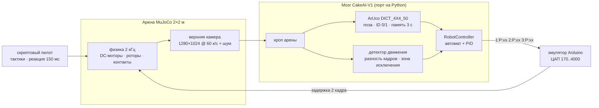
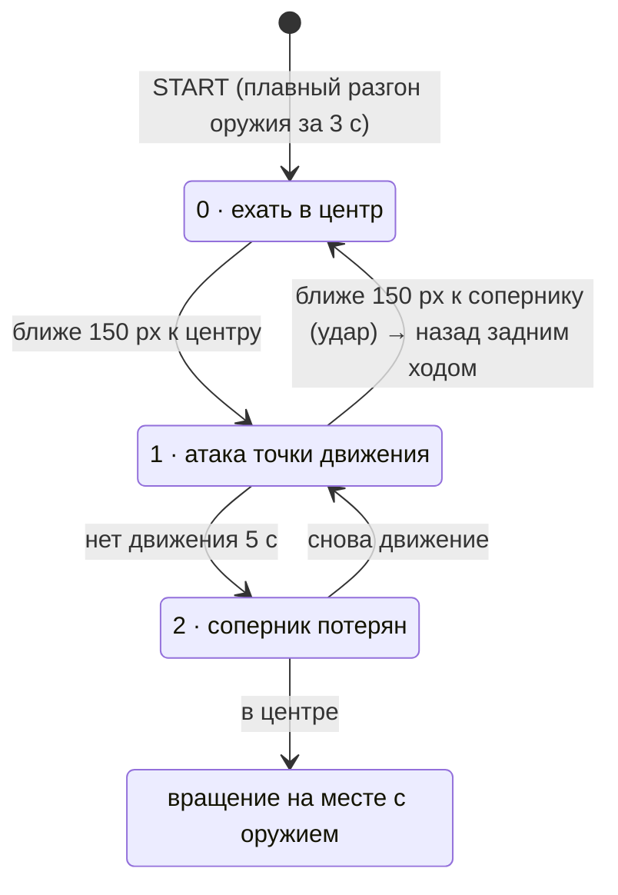

<div align="center">

# 🎂🤖 CakeAI Arena

### Симулятор боёв **автономных роботов 1.5 кг** на MuJoCo. ИИ робота дерётся, видя арену своими глазами: одна верхняя камера.

[](https://github.com/GeBondar/cakeai-arena/actions/workflows/ci.yml)


[](LICENSE)

[English](README.md) · **Русский**


<sub>Слева — что видит ИИ: себя он находит по ArUco-маркеру, соперника — по движению. Справа — камера трансляции.</sub>

</div>

---

**CakeAI Arena** запускает в физической арене настоящий «мозг» робота [**CakeAI-V1**](https://github.com/Vlad326/CakeAI-V1). Это автономный «Торт ИИ», который выступал на Крашилово 25 апреля 2026 года. Логика зрения и управления работает без изменений и получает на вход только пиксели с симулированной верхней камеры: никаких истинных координат и подсказок. Против него — четыре типа роботов по 1.5 кг, сделанные в CAD, с честной физикой роторов.

- 🎥 **Камера в контуре.** Рендер 1280×1024 сверху идёт в конвейер CakeAI: кроп, ArUco, детектор движения, автомат состояний. На выходе — строки `1:P:73` → эмулятор Arduino → моторы.
- 🦾 **Пять роботов ровно по 1.500 кг.** Смоделированы кодом методом CADAM (CadQuery). Инерция берётся прямо из CAD-тел.
- ⚔️ **Оружие на настоящей физике.** Барабан, вертикальный диск, горизонтальная балка, флиппер и клин. Удары считаются по энергии, которую ротор реально теряет в контакте.
- 📺 **Видео как на трансляции.** HUD, полоски HP, лента ударов и окно самого ИИ рядом.
- 🎮 **Можно сыграть против него.** Ведёшь любого соперника с клавиатуры, CakeAI отвечает сам.
- ✅ **Работает на Windows, macOS и Linux (в том числе без дисплея).** Тесты покрывают порт ИИ, физику каждого робота и маркеры на рендере.

## 🎬 Смотреть

| | |
|:---:|:---:|
| <br>**против TORNADO**: горизонтальный спиннер, 147 Дж | <br>**против CATAPULT**: электрический флиппер |
| <br>**против RAZOR**: вертикальный дисковый спиннер, 193 Дж | <br>**против DOORSTOP**: клин |
| <br>**CakeAI стартует вверх ногами** и воюет по маркеру ID 1 | <br>**против DOORSTOP-Z**: заход зигзагом |

▶️ Полные бои лежат в [`media/videos/`](media/videos), минутная нарезка — в [`media/videos/highlights.mp4`](media/videos/highlights.mp4).

## 🤖 Роботы


| | Робот | Оружие | Энергия / мощность | Габарит, мм | Скорость |
|---|---|---|---|---|---|
| 🎂 | **CakeAI** (автономный) | передний барабан, 9 000 об/мин. **Переворачиваемый**: ArUco ID 0 сверху, ID 1 снизу | 25 Дж | 206 × 196 × 64 | 2.6 м/с |
| 🔴 | **RAZOR** | вертикальный диск Ø100, 10 000 об/мин | 193 Дж | 248 × 150 × 116 | 2.2 м/с |
| 🟠 | **TORNADO** | горизонтальная балка 170 мм (андеркаттер), 6 000 об/мин | 147 Дж | 307 × 160 × 64 | 2.0 м/с |
| 🔵 | **DOORSTOP** | клин, кромка 2 мм | нет | 230 × 180 × 64 | 2.4 м/с |
| 🟢 | **CATAPULT** | электрический флиппер, 9 Н·м, 95°. Встаёт сам после переворота | нет | 242 × 192 × 64 | 2.3 м/с |

Все пятеро весят **1.500 кг**. Каждый описан одним CadQuery-скриптом: [`cad/robots_1p5kg/make_step.py`](cad/robots_1p5kg/make_step.py). STEP-файлы открываются в любом CAD, STL-меши идут в симулятор. Самопроверка в [`check_report.txt`](cad/robots_1p5kg/check_report.txt) охватывает массы, пересечения деталей и зазор до пола.

## 🧠 Как это работает




**Мозг в разборе.** Вот что [CakeAI-V1](https://github.com/Vlad326/CakeAI-V1) делает на каждом кадре:



- **Своя поза.** ArUco `DICT_4X4_50`, курс — вектор TL→TR маркера. **ID 1 — робот перевёрнут**: каналы привода меняются местами и инвертируются, бой продолжается.
- **Поиск соперника.** Разность кадров → порог 25 → морфология → центр крупных пятен. Вокруг своего робота вырезается зона 120 px со сдвигом на 10 px вперёд.
- **Руление.** PID по ошибке курса (Kp 0.25, Kd 0.05, ×1.55) плюс ход вперёд, который сходит на нет к 90° ошибки. После удара — задним ходом в центр.
- **Детектор застревания.** Если за 3 с робот сдвинулся меньше чем на 30 px и повернулся меньше чем на 10°, он крутится на месте, а скорость оружия «качается» 100 → 50 → 100 %.
- **Выход.** Строки `N:P:xx` по serial на Arduino, там три ЦАП MCP4725 эмулируют стики пульта. CH1 — левый борт, CH2 — правый, CH3 — оружие, 50 % — стоп.

Порт в [`cakeai/`](cakeai) повторяет C++ построчно. Заменены только часы (время симулятора) и COM-порт (эмулятор). Настройки — те, с которыми CakeAI выступал на Крашилово: [`configs/cakeai_crashilovo.ini`](configs/cakeai_crashilovo.ini). Камера поставлена так, что арена ложится ровно в кроп из этого конфига, (193,70)–(1085,945).

## 🚀 Быстрый старт

```bash
git clone https://github.com/GeBondar/cakeai-arena
cd cakeai-arena
pip install -r requirements.txt
python -m arena fight hspin          # → out/fight_hspin_s0.mp4
```

Нужен Python 3.9 или новее, больше ничего ставить не надо: ffmpeg идёт в `imageio-ffmpeg`, MuJoCo и OpenCV — из pip.

| Команда | Что делает |
|---|---|
| `python -m arena fight <соперник>` | один бой: видео и JSON. Опции: `--secs 60 --seed 0 --tactic juke --flip --fps 60 --latency 2 --no-video` |
| `python -m arena tournament -j 3` | все бои параллельно, на выходе `out/results.md` и `out/all_fights.mp4` |
| `python -m arena play --robot flipper` | 🎮 соперником управляешь **ты**: WASD, ПРОБЕЛ — оружие, R — заново. Нужен `pip install pygame` |
| `python -m arena roster` | список соперников |
| `python -m arena check` | проверка, что CakeAI видит маркеры на рендере с верным курсом, в обычном и перевёрнутом положении |
| `python tools/make_media.py --fights out/tournament` | пересобирает все картинки, GIF и видео README |
| `pytest -q` | тесты (20) |

<details>
<summary><b>Linux без дисплея / серверы / CI</b></summary>

Рендеру нужен OpenGL. Без дисплея арена сама переключается на `MUJOCO_GL=egl`. Если EGL нет:

```bash
sudo apt-get install -y libosmesa6-dev
export MUJOCO_GL=osmesa PYOPENGL_PLATFORM=osmesa
```

Только физика и порт ИИ, без OpenGL: `pytest -q -m "not render"`.
</details>

<details>
<summary><b>Пересобрать CAD-модели</b></summary>

```bash
pip install cadquery
python cad/robots_1p5kg/make_step.py          # все роботы
python cad/robots_1p5kg/make_step.py flipper  # только один
```
</details>

## 🏆 Результаты

**CakeAI: 5 побед, 2 поражения** из 7 боёв (лимит 60 с, все закончились нокаутом).

| # | Соперник | Старт CakeAI | Итог | Время | HP CakeAI / соперника | Удары CakeAI · энергия | Перевороты (CakeAI → / ← соп.) | Видео |
|---|---|---|---|---|---|---|---|---|
| 1 | **RAZOR** (вертикальный спиннер) | обычный | ❌ RAZOR · KO, HP 0 | 14.6 s | 0 / 65 | 10 · 22 Дж | 2 / 2 | [mp4](media/videos/fight_vspin_s0.mp4) |
| 2 | **TORNADO** (горизонтальный спиннер) | обычный | ❌ TORNADO · KO, HP 0 | 11.0 s | 0 / 35 | 12 · 41 Дж | 0 / 0 | [mp4](media/videos/fight_hspin_s0.mp4) |
| 3 | **DOORSTOP** (клин) | обычный | 🏆 **CakeAI** · KO, HP 0 | 18.2 s | 100 / 0 | 17 · 65 Дж | 0 / 0 | [mp4](media/videos/fight_wedge_s0.mp4) |
| 4 | **CATAPULT** (флиппер) | обычный | 🏆 **CakeAI** · KO, переворот | 20.9 s | 100 / 63 | 11 · 23 Дж | 4 / 4 | [mp4](media/videos/fight_flipper_s0.mp4) |
| 5 | **RAZOR-O** (вертикальный спиннер, кружит) | обычный | 🏆 **CakeAI** · KO, переворот | 9.9 s | 100 / 97 | 3 · 2 Дж | 1 / 0 | [mp4](media/videos/fight_vspin-orbit_s1.mp4) |
| 6 | **DOORSTOP-Z** (клин, зигзаг) | обычный | 🏆 **CakeAI** · KO, переворот | 18.0 s | 100 / 27 | 14 · 46 Дж | 1 / 0 | [mp4](media/videos/fight_wedge-zigzag_s2.mp4) |
| 7 | **CATAPULT** (флиппер) | вверх ногами | 🏆 **CakeAI** · KO, HP 0 | 24.8 s | 100 / 0 | 23 · 63 Дж | 7 / 3 | [mp4](media/videos/fight_flipper_s3_flip.mp4) |

Соперниками управляют скриптовые пилоты, а не люди: реакция 150 мс, шум руки, отъезд после клинча. Результаты показывают, что контур «камера → ИИ → моторы» работает и как он держится против каждого типа оружия. Это не прогноз против живых пилотов. Проверить самому можно через `python -m arena play`.

## ⚙️ Физическая модель

| | |
|---|---|
| Движок | MuJoCo 3, интегратор `implicitfast`, шаг 0.5 мс (2 кГц), эллиптические конусы трения |
| Арена | 2 × 2 м, стальной борт 5 см и поликарбонат 40 см, крашеный пол (μ 0.25), резиновые шины (μ 0.95) |
| Привод | коллекторный DC-мотор на колесо, τ = T<sub>stall</sub>·(u − ω/ω<sub>free</sub>), u — скважность из ЦАП. Танковый поворот, корпус волочится по полу |
| Спиннеры | физические роторы с инерцией из CAD на DC-моторах (разгон примерно 1–1.5 с), коллизии по выпуклым оболочкам |
| Флиппер | плита на шарнире, серво положения с ограничением момента 9 Н·м, выстрел 0.25 с, перезарядка 0.7 с |
| Камера | пинхол на высоте 2.5 м, вертикальный угол обзора 51.5°, шум σ = 2, задержка камера→мотор 2 кадра |
| Урон | энергия удара — потеря кинетической энергии ротора за эпизод контакта. 1 Дж ≈ 1.6 % HP, не больше 30 % за удар |
| KO | HP 0 или переворот без самоподъёма дольше 5 с. CakeAI переворачиваемый, поэтому лёжа на спине не проигрывает |

## 🗂️ Структура

```
cakeai/            порт CakeAI-V1: PID, RobotController, ArUco + движение, главный цикл, эмулятор Arduino
arena/             симулятор: MJCF-сцена, матч и счёт, пилоты, видео-трансляция, режим игры, CLI
cad/robots_1p5kg/  CADAM-модели: make_step.py → STEP/STL деталей, robots.json (масса, ЦМ, инерция)
configs/           боевой конфиг CakeAI (Крашилово, 25.04.2026)
media/             картинки README, GIF, видео боёв, результаты
tools/             make_media.py — пересборка всех медиа
tests/             порт ИИ, физика каждого робота, маркеры на рендере, короткие бои с камерой в контуре
```

## ⚠️ Честные ограничения

- Контакт в MuJoCo мягкий, коллизии считаются по выпуклым оболочкам. Броня не ломается и не гнётся, так что HP — модель счёта, а не разрушения.
- Камера — идеальный пинхол: без дисторсии, смаза и автоэкспозиции. Реальный CakeAI снимал с короткой выдержкой (`CameraExposure=-9`), поэтому смаз невелик. Добавить реализма можно в `render_overhead()`.
- Эмуляция ESC и стиков линейная, без мёртвых зон.
- Как выглядит настоящий «Торт ИИ», нигде не опубликовано. Модель выведена из кода: переворачиваемый, дифференциальный привод, активное оружие с плавным стартом. Барабан — допущение.
- Это порт на Python, а не исходный C++. Чтобы гонять оригинальный бинарник, замените `ArduinoController` на сокет и подавайте в `cv::VideoCapture` кадры из симулятора.

## 🙏 Благодарности

- **CakeAI-V1**: © 2026 Влад Колмогоров ([@Vlad326](https://github.com/Vlad326)), Apache-2.0. Это тот самый мозг, который здесь симулируется. Поставьте звезду оригиналу!
- Подход к симулятору (MJCF-роботы, счёт контактов, тактики пилотов) взят из **GeBondar/battlebots_docs**.
- 3D-модели сделаны методом **CADAM** (код-первый CAD на CadQuery / OpenCascade).
- [MuJoCo](https://mujoco.org) от Google DeepMind и [OpenCV](https://opencv.org).

## 📄 Лицензия

[Apache-2.0](LICENSE). Атрибуция порта CakeAI-V1 — в [NOTICE](NOTICE). Для цитирования есть [CITATION.cff](CITATION.cff).

<div align="center"><sub>Сделано с 🎂 — <a href="https://github.com/GeBondar">GeBondar</a></sub></div>
